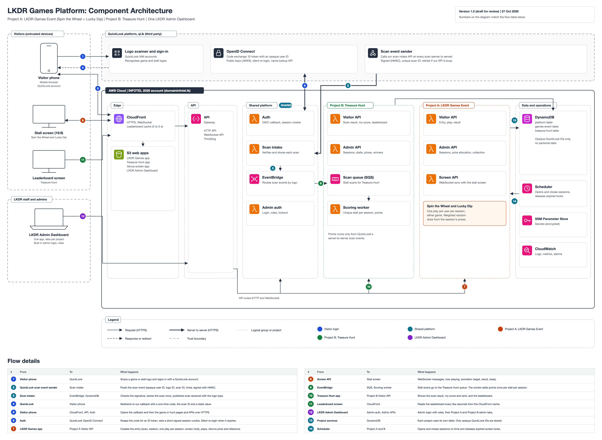
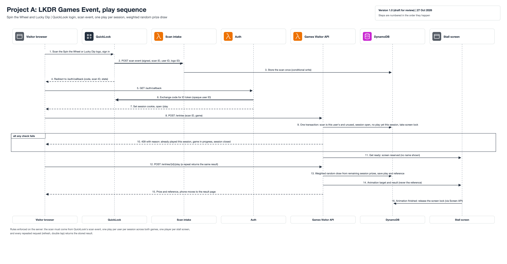
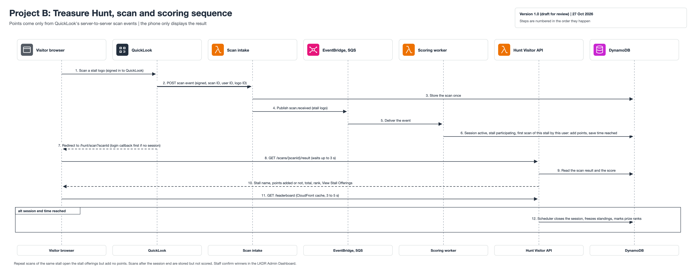

# Architecture

## 1. Overview

The platform is fully serverless on AWS. It has four parts:

| Part | Contents |
|---|---|
| **Frontend apps** (S3 + CloudFront) | LKDR Games app, Treasure Hunt app, Venue screen app, LKDR Admin Dashboard |
| **Shared platform** | Auth (QuickLook login), Scan intake (webhook), EventBridge, Admin auth |
| **Project A: LKDR Games Event** | Visitor API, Admin API, Screen API (WebSocket) |
| **Project B: Treasure Hunt** | Visitor API, Admin API, Jobs (reads QuickLook's Leaderboard API) |

Data is stored in DynamoDB, one table per area (platform, games-event, treasure-hunt). EventBridge Scheduler opens and closes sessions on time. Secrets are in SSM Parameter Store, and logs and alarms are in CloudWatch.

## 2. Boundaries

| Boundary | Trust | Contents |
|---|---|---|
| Visitors | Untrusted | Visitor phones, stall screen, leaderboard screen |
| LKDR staff and admins | Authenticated, role-based | Admin dashboard in a browser |
| QuickLook platform | Third party, verified by signatures | Sign-in, logo scanner, scan event sender |
| AWS Cloud (INFOTEL 2026 account) | Our system | Everything we build and run |

## 3. Components

### 3.1 Frontend apps
| App | Users | Purpose |
|---|---|---|
| LKDR Games app | Visitors | Spin the Wheel and Lucky Dip: entry, play, result |
| Treasure Hunt app | Visitors | Scan result, my score, leaderboard, stall offerings link |
| Venue screen app | Stall screen, leaderboard screen | Project A live game display (WebSocket), Project B leaderboard (cached polling) |
| LKDR Admin Dashboard | LKDR staff and admins | Sessions, prizes, live control, prize desk, stalls, winners, reports, users |

Details: [frontend.md](frontend.md).

### 3.2 Shared platform
| Component | Responsibility |
|---|---|
| Auth (Lambda) | QuickLook OpenID Connect login, callback, signed session cookie, silent re-login |
| Scan intake (Lambda) | Receives QuickLook scan events, verifies the HMAC signature, stores each scan once, publishes `scan.received` |
| EventBridge (bus) | Routes scan events by logo type to the right project |
| Admin auth (Lambda) | Admin login, roles, lockout, admin users, audit log |

### 3.3 Project A: LKDR Games Event
| Component | Responsibility |
|---|---|
| Visitor API (Lambda) | Entries, one play per session, screen lock, weighted random prize draw, results |
| Admin API (Lambda) | Prize catalogue, sessions, allocations, live control, prize desk, reports, settings |
| Screen API (Lambda, WebSocket) | Keeps the stall screen in sync: now playing, animation target, result, ready |

### 3.4 Project B: Treasure Hunt
| Component | Responsibility |
|---|---|
| Hunt jobs (Lambda, every minute) | Reads the standings from QuickLook's Leaderboard API every 15 seconds while a session runs, then works out the winners (decision D-18) |
| Visitor API (Lambda) | Scan result, my score and rank, leaderboard |
| Admin API (Lambda) | Sessions, session prizes, stalls, participants and scans, winners, reports |

Details: [backend.md](backend.md).

## 4. Third-party communication (QuickLook)

| Direction | What | How |
|---|---|---|
| Visitor to QuickLook | Sign-in and logo scan | QuickLook app or ql.lk |
| QuickLook to our API | Scan event for every scan | HTTPS POST, HMAC signature, unique scan ID, retries |
| QuickLook to visitor browser | Opens our logo URL with the scan ID | Browser redirect |
| Our Auth to QuickLook | Code exchange, public keys, silent re-login | OpenID Connect (server to server for the code exchange) |
| Our Admin API to QuickLook | Display name of one winner for the prize desk | Lookup API, client credentials, result not stored |

Contract: [integration-contract.md](../06-quicklook-integration/integration-contract.md).

## 5. Main flows

| Flow | Diagram |
|---|---|
| Spin the Wheel or Lucky Dip play | [02-games-event-play-sequence.png](diagrams/02-games-event-play-sequence.png) |
| Treasure Hunt scan and scoring | [03-treasure-hunt-scan-sequence.png](diagrams/03-treasure-hunt-scan-sequence.png) |

## 6. AWS resources

| Stack | Resources |
|---|---|
| Web | S3 buckets (4 apps), CloudFront distribution, ACM certificate |
| Platform | API Gateway HTTP API, Auth, Scan intake and Admin auth Lambdas, EventBridge bus and rules, `platform` DynamoDB table, SSM parameters |
| Games Event (Project A) | Visitor, Admin and Screen Lambdas, API Gateway WebSocket API, `games-event` DynamoDB table, Scheduler schedules |
| Treasure Hunt (Project B) | Visitor, Admin and Jobs Lambdas, `treasure-hunt` DynamoDB table, every-minute schedule |
| Monitoring | CloudWatch dashboard, alarms, AWS Budgets alert |

Each stack is deployed with AWS CDK. See [environments and deployment](../07-delivery/environments-and-deployment.md).

## 7. Related documents

[Security](security.md), [Scalability](scalability.md), [Decisions](../01-overview/decisions.md).
